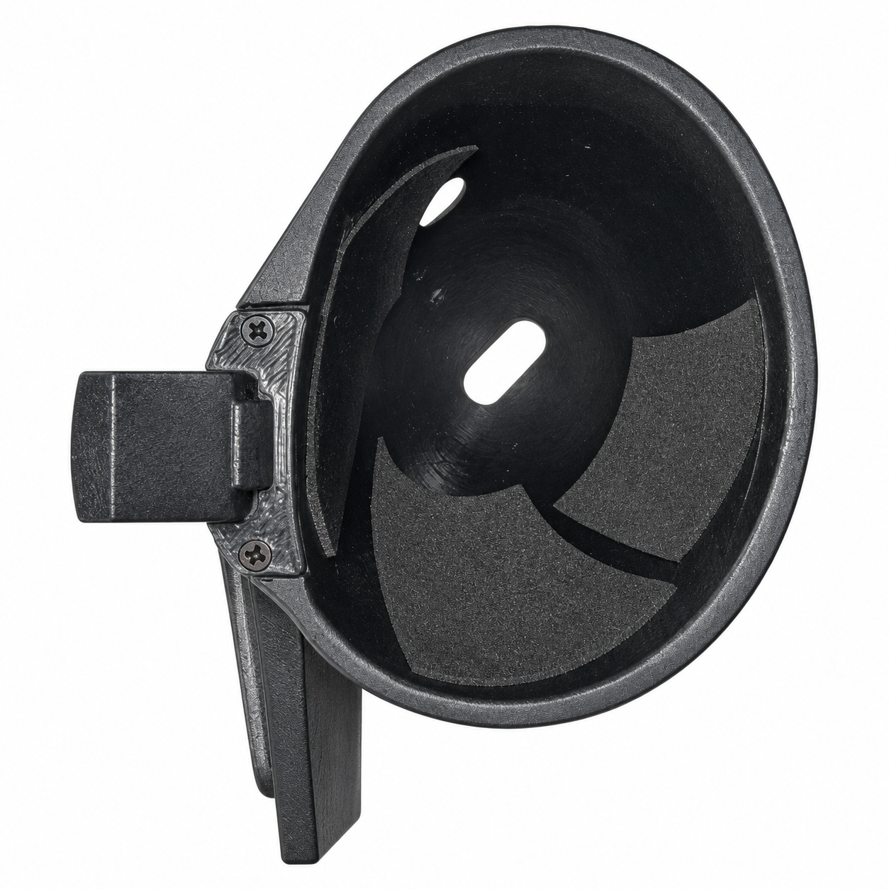
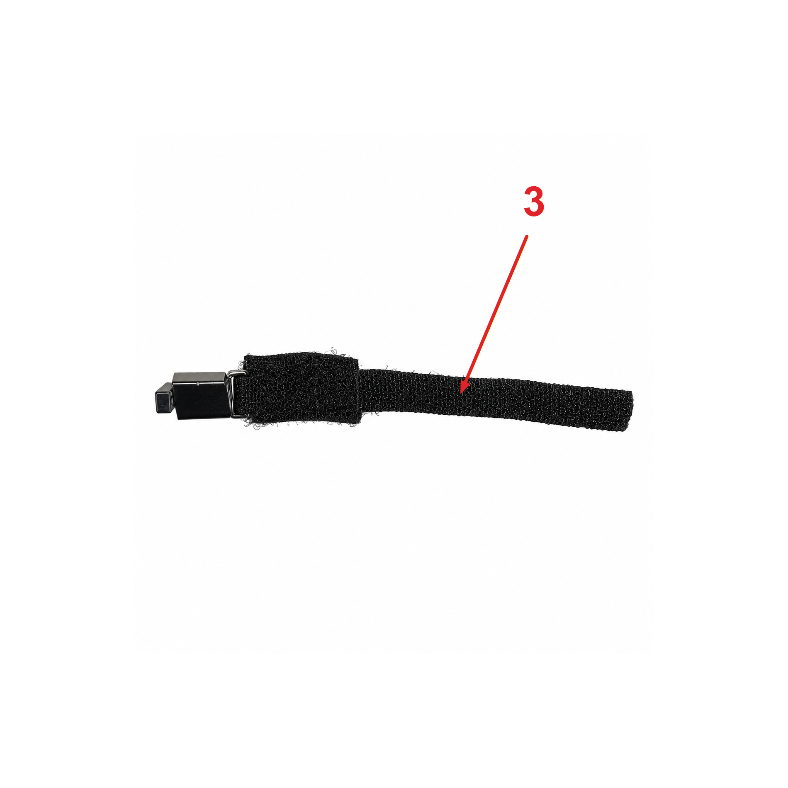

# Sharpa Avatar Adapters

Mechanical adapters and coordinate transforms for the Sharpa Avatar AE01. This repository contains 10 STEP models and five right-hand transforms.

## Repository Structure
```te
.
├── assembly_photos/
├── models/
│   └── AE01/
│       ├── vive_tracker/
│       ├── pico_controller/
│       └── meta_touch_plus_and_pro/
├── LICENSE
└── README.md
```

| Trackers | Model folder | Files |
| --- | --- | --- |
| VIVE&nbsp;Tracker<br>VIVE&nbsp;Ultimate&nbsp;Tracker | [vive_tracker](models/AE01/vive_tracker/) | `vive_tracker_adapter_AE01.step` |
| PICO&nbsp;controller | [pico_controller](models/AE01/pico_controller/) | `pico_adapter_AE01_left.step`<br>`pico_adapter_AE01_right.step`<br>`pico_cover_AE01_left.step`<br>`pico_cover_AE01_right.step` |
| Meta&nbsp;Quest&nbsp;Touch&nbsp;Plus<br>Meta&nbsp;Quest&nbsp;Touch&nbsp;Pro | [meta_touch_plus_and_pro](models/AE01/meta_touch_plus_and_pro/) | `meta_touch_plus_and_pro_adapter_AE01_left.step`<br>`meta_touch_plus_and_pro_adapter_AE01_right.step`<br>`meta_touch_plus_and_pro_switch_AE01.step`<br>`meta_touch_plus_and_pro_switch_stop_AE01.step`<br>`meta_touch_plus_fixture.step` |

## Assembly Instruction

### Meta Quest Touch Plus/Pro

Required purchased parts:

| No. | Name | Quantity | Link |
| --- | --- | --- | --- |
| 1 | Low-profile head self-tapping screw, 2.0 × 3.0 mm | 2 | [link](https://detail.tmall.com/item.htm?id=769997219983&skuId=5610253119978) |
| 2 | Low-profile head self-tapping screw, 1.2 × 2.5 mm | 2 | [link](https://detail.tmall.com/item.htm?id=672312875866&skuId=5005897262292) |
| 3 | Hook-and-loop fastener, 5 mm in width     | As needed | [link](https://item.taobao.com/item.htm?id=973485212347&skuId=6117318143425) |
| 4 | Single-sided EVA foam tape, 0.5 mm thick | As needed | [link](https://item.taobao.com/item.htm?id=869810148755&skuId=5697737852507) |
| 5 | Spring-loaded ball plunger with collar, Ø4 × 5 mm | 2 | [link](https://detail.tmall.com/item.htm?id=1009059142232&skuId=6206482278045) |

<p>
  <a href="assembly_photos/meta_touch_assembly_01.png"></a>
  <a href="assembly_photos/meta_touch_assembly_02.png"></a>
  <a href="assembly_photos/meta_touch_assembly_03.png"></a>
</p>

## Coordinate transforms

All five matrices below are **right-hand** transforms named `T_mount_tracker`. They map tracker/controller coordinates into `right_hand_mount_frame` using homogeneous column vectors:
```t
p_mount = T_mount_tracker @ p_tracker

T_mount_tracker = [ R  t ]
                  [ 0  1 ]

T_world_mount = T_world_tracker @ inverse(T_mount_tracker)
```

Each column of `R` is a positive tracker basis axis expressed in mount coordinates. Translation unit is mm.

### VIVE Tracker 3.0

```text
[ 0  -1  0  -10.5 ]
[ 1   0  0    0   ]
[ 0   0  1   17.5 ]
[ 0   0  0    1   ]
```

### VIVE Ultimate Tracker

```text
[ -1   0  0  -20.6 ]
[  0  -1  0    0   ]
[  0   0  1  -19.1 ]
[  0   0  0    1   ]
```

### PICO controller

```text
[ -0.99871     0.050223   0.0069817   -8.0421 ]
[  0.0037749   0.21095   -0.97749    15.278  ]
[ -0.050566   -0.97621   -0.21087   -59.188  ]
[  0          0          0           1      ]
```

### Meta Quest Touch Plus

```text
[ -0.98798   -0.085132   0.12907   -24.981 ]
[ -0.1244    -0.05803   -0.99053    46.203 ]
[  0.091816  -0.99468    0.046742  -38.765 ]
[  0         0          0           1     ]
```

### Meta Quest Touch Pro

```text
[ -0.99205   -0.069042   0.10526   -23.086 ]
[ -0.098608  -0.093511  -0.99072    48.502 ]
[  0.078244  -0.99322    0.085959  -37.87  ]
[  0         0          0           1     ]
```

## License and support

See [LICENSE](LICENSE) for the current license status, which remains pending owner review.

Hardware and integration support: [support@sharpa.com](mailto:support@sharpa.com).
